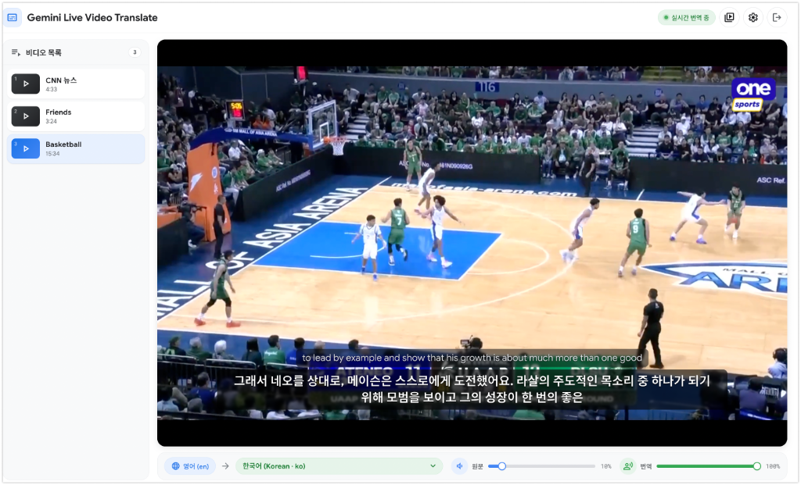

# Google Gemini 3.5 Live Video Translate

`gemini-3.5-live-translate-preview` 모델과 Google GenAI SDK (`google-genai`)를 활용한 **비디오 실시간 번역(자막 + 더빙 음성)** 웹 애플리케이션입니다.
GCS 버킷에 등록된 비디오를 선택해 재생하면 음성 언어를 자동 감지하고, 번역 자막을 영상 위에 오버레이로 표시하며 번역 음성을 원문 음성과 믹싱해 재생합니다.



---

## 🖥️ 화면 구성

| 영역 | 설명 |
| :--- | :--- |
| **상단 헤더** | 세션 상태 (`대기 중` / `세션 연결 중` / `실시간 번역 중` / `일시정지` / `번역 완료`), 비디오 목록 토글, 설정 ⚙️, 로그아웃 |
| **좌측 사이드바** | GCS 버킷의 `videos.json`에 정의된 비디오 목록. 클릭 시 재생 + 번역 세션 시작 |
| **플레이어** | 기본 HTML5 `<video controls>` + **번역 자막 오버레이 (최대 2줄, 전체화면에서도 표시)**. 설정에서 원문 자막 동시 표시 가능 |
| **컨트롤 바** | 감지된 원문 언어 배지 → Target 언어 선택(78개), **원문 볼륨 (기본 10%)**, **번역 음성 볼륨 (기본 100%)**, 음소거 버튼 |
| **설정 모달** | 번역 음성 선택, 자동 더킹(기본 OFF), 원문 동시 표시, 자막 크기(소/중/대), `echo_target_language` |

> 모든 설정과 볼륨·타겟 언어·마지막 선택 비디오는 `localStorage`에 저장되어 재방문 시 복원됩니다.

---

## ✨ 주요 기능

1. **Gemini 3.5 Live Translate 연동 (`gemini-3.5-live-translate-preview`)**
   - 입력: 비디오 오디오를 Web Audio API로 캡처 → 16kHz 16-bit Mono PCM → WebSocket 스트리밍
   - 출력: 번역 음성(24kHz PCM, WebSocket 바이너리 프레임) + `input/output_audio_transcription` 자막
   - 소스 언어는 모델이 자동 감지 (컨트롤 바에 감지 언어 배지 표시)
2. **독립적인 오디오 믹싱**
   - `createMediaElementSource` → `videoGain`(영상별 보정) → `sourceGain`(원문) / 서버 수신 PCM → `targetGain`(번역) 으로 완전히 분리된 볼륨 제어
   - **자동 더킹(선택)**: 번역 음성이 실제로 발화 중인 구간(무음 패킷 제외)에만 원문 볼륨을 50%로 추가 감쇠
3. **자막 오버레이**
   - 번역문을 문장 단위로 실시간 갱신, 최대 2줄 유지 (오래된 문장부터 제거, 긴 문장은 앞부분을 `…`로 잘라냄)
   - 옵션으로 원문을 작은 글씨로 함께 표시
4. **재생과 세션 연동**
   - 비디오 선택 시 세션 연결, **재생 중에만** 오디오 전송, 일시정지 시 전송 중단(세션 유지)
   - 탐색(seek)·비디오 변경·타겟 언어/음성 변경 시 세션 재연결 + 자막/오디오 버퍼 초기화
   - 영상 종료 후 남은 번역 음성이 끝날 때까지 대기한 뒤 세션 종료
5. **송출 지연(Playout Delay)으로 자막·더빙 싱크** — `PLAYOUT_DELAY_SECONDS` (기본 4.0)
   - 숨김 `<audio>` 피더가 **재생 위치보다 D초 앞선 오디오**를 모델에 먼저 보내고, 보이는 영상은 재생/탐색 시 D초 동안 "번역 준비 중" 후 시작
   - 모델 지연이 D 안에 흡수되어 자막·더빙이 발화와 거의 동시에 나옴. 방송 송출 지연 버퍼(5–10초)와 같은 원리라 라이브 스트림에도 동일하게 적용 가능
   - `0`으로 두면 즉시 재생하고 번역이 모델 지연만큼 뒤따름
   - 자막은 더빙보다 0.5–0.8s 먼저 나와 읽을 시간을 줌
6. **GCS 기반 비디오 저장소**
   - 비디오 파일과 `videos.json`을 GCS 버킷(`VIDEOS_GCS_BUCKET`)에서 읽어 **8 MiB 단위 206 Partial Content**로 스트리밍 (Cloud Run의 32 MiB 단일 응답 제한 회피, 탐색 지원)
   - 환경변수가 비어 있으면 로컬 `videos/` 폴더로 폴백
7. **세션 관리**: `ContextWindowCompressionConfig`, `SessionResumptionConfig`, `GoAway` 자동 재연결, 무입력 자동 종료
8. **로그인 게이트**: 공유 비밀번호 + HMAC 서명 쿠키. `/media/*`, `/api/*`도 로그인 없이는 접근 불가

### 번역 지연 특성 (실측)

| 항목 | 측정값 |
| :--- | :--- |
| 세션 첫 발화 | 약 **3초** (시동 지연, 1회) |
| 짧은 발화(2.5s) + 무음 반복 | 원문 전사 +1.0–1.5s, 번역 텍스트 +1.1–2.0s, 번역 음성 +1.8–2.5s |
| **연속 발화(뉴스)** — 더빙 음성 | 원문 대비 **약 4.0s 지연** (원문/더빙 포락선 상호상관으로 측정) |
| **연속 발화(뉴스)** — 자막 | 더빙보다 약 0.5–0.8s 먼저 도착 |
| 청크 크기(20–250ms)·VAD 설정·세션 옵션 | 영향 없음 |
| 텍스트 전용 모드 | 없음 — 번역 텍스트는 음성의 전사본이라 동시에 도착 |

→ API 설정으로는 줄일 수 없으므로 `PLAYOUT_DELAY_SECONDS`(기본 4.0)로 흡수합니다. 4.0에서 더빙이 영상과 ±0.5s 이내로 맞고, 자막은 더빙보다 약간 먼저 나와 읽을 여유가 생깁니다. 자막만 쓰고 더빙을 끈다면 3.0~3.5로 줄여도 됩니다.

---

## 📁 프로젝트 구조

```text
live-translate-video/
├── app/
│   ├── config.py          # 환경변수, GenAI 클라이언트 팩토리, 78개 언어, 음성 프리셋, GCS 설정
│   └── main.py            # FastAPI 서버, 로그인 게이트, /api/videos, /media 범위 스트리밍, /ws/translate
├── static/
│   ├── index.html         # 사이드바 + 플레이어 + 자막 오버레이 + 컨트롤 바 + 설정 모달
│   ├── login.html
│   ├── styles.css         # Google 4-Color 화이트 테마
│   └── app.js             # Web Audio 캡처/재생, WebSocket, 자막, 더킹, 설정 저장
├── videos/
│   ├── videos.json        # 비디오 목록 메타데이터 (git 추적, GCS에 동일 파일 업로드)
│   └── *.mp4              # 원본 영상 (git 제외, GCS 버킷에 업로드)
├── docs/
│   └── screenshot-video-translate.png
├── Dockerfile
├── requirements.txt
└── README.md
```

### 비디오 추가 방법

1. `videos/videos.json`에 항목을 추가합니다.
2. 영상 파일과 `videos.json`을 버킷에 업로드합니다. 앱은 재배포 없이 새로고침만으로 목록을 반영합니다.

```bash
gcloud storage cp videos/새영상.mp4 gs://<VIDEOS_GCS_BUCKET>/ --content-type=video/mp4 --project=<YOUR_GCP_PROJECT_ID>
gcloud storage cp videos/videos.json gs://<VIDEOS_GCS_BUCKET>/videos.json --content-type=application/json --project=<YOUR_GCP_PROJECT_ID>
```

```json
{
  "videos": [
    { "id": "source_video_1", "title": "CNN 뉴스",   "file": "source_video_1.mp4", "duration": 273, "gain": 1.0, "description": "" },
    { "id": "source_video_2", "title": "Friends",    "file": "source_video_2.mp4", "duration": 204, "gain": 2.5, "description": "" },
    { "id": "source_video_3", "title": "Basketball", "file": "source_video_3.mp4", "duration": 934, "gain": 2.5, "description": "" }
  ]
}
```

| 필드 | 설명 |
| :--- | :--- |
| `id` | 고유 식별자 (마지막 선택 비디오 복원에 사용) |
| `title` | 목록에 표시되는 제목 |
| `file` | 버킷(또는 `VIDEOS_GCS_PREFIX`) 기준 객체 이름 |
| `duration` | 초 단위 길이 (목록 표시용, 선택) |
| `gain` | 원문 오디오 보정 배율 (기본 1.0, 최대 4.0). 번역 음성은 약 -19 dB 평균 음량으로 생성되므로 원본이 작은 영상(-27 dB 등)은 2.0~3.0 권장 |
| `description` | 부가 설명 (선택) |

> Cloud Run 서비스 계정에는 버킷에 대한 `roles/storage.objectViewer`가 필요합니다. 버킷에 `allUsers` 공개 읽기 권한이 있으면 영상이 로그인 게이트와 무관하게 공개 URL로 노출되므로 비공개 버킷 사용을 권장합니다.

---

## ⚙️ 환경변수 (`.env`)

```bash
cp .env.example .env
```

```dotenv
# 인증 모드: adc (기본값, Google Cloud ADC / Vertex AI) 또는 api_key
AUTH_MODE=adc

# ADC 모드 사용 시 GCP 프로젝트 및 리전 (gemini-3.5-live-translate-preview는 global 리전 사용)
GOOGLE_CLOUD_PROJECT=<YOUR_GCP_PROJECT_ID>
GOOGLE_CLOUD_LOCATION=global

# API Key 모드 사용 시 (AUTH_MODE=api_key)
GEMINI_API_KEY=

# 모델 설정
LIVE_TRANSLATE_MODEL=gemini-3.5-live-translate-preview

# 무입력 자동 세션 종료 (초)
INACTIVITY_TIMEOUT_SECONDS=600

# 로그인 게이트 (비워두면 로그인 비활성화)
APP_LOGIN_PASSWORD=<YOUR_SHARED_PASSWORD>
APP_SESSION_SECRET=<RANDOM_HEX_SECRET>
APP_SESSION_HOURS=12

# 비디오 저장소: GCS 버킷 이름 (gs:// 제외). 비워두면 로컬 videos/ 폴더 사용
VIDEOS_GCS_BUCKET=live-translate
# 버킷 내 객체 접두사 (예: videos). 비워두면 버킷 루트
VIDEOS_GCS_PREFIX=

# 송출 지연(초). 보이는 영상을 이만큼 늦추고 그만큼 앞선 오디오를 모델에 먼저 보내 자막/더빙 싱크를 맞춤 (0 = 끔)
PLAYOUT_DELAY_SECONDS=4.0
```

| 변수 | 설명 |
| :--- | :--- |
| `APP_LOGIN_PASSWORD` | 로그인 화면에서 입력할 고정 비밀번호 |
| `APP_SESSION_SECRET` | 로그인 쿠키를 HMAC 서명하는 비밀키. 운영 환경에서는 반드시 고정값 지정 |
| `APP_SESSION_HOURS` | 로그인 쿠키 유효 시간 |
| `VIDEOS_GCS_BUCKET` | 비디오 파일과 `videos.json`을 읽을 GCS 버킷 |
| `VIDEOS_GCS_PREFIX` | 버킷 내 하위 경로 (선택) |
| `PLAYOUT_DELAY_SECONDS` | 송출 지연(초, 0–10, 기본 4.0). 0이면 선행 피더 비활성 |

---

## 💻 로컬 실행 방법

```bash
gcloud auth application-default login   # Vertex AI / GCS 호출용 ADC
python3 -m venv .venv
./.venv/bin/pip install -r requirements.txt
./.venv/bin/python -m uvicorn app.main:app --host 0.0.0.0 --port 8000 --reload
```

브라우저에서 **[http://localhost:8000](http://localhost:8000)** 접속 → 로그인 → 비디오 선택.
`VIDEOS_GCS_BUCKET`을 비우면 `videos/` 폴더의 파일을 직접 서빙합니다.

---

## ☁️ Cloud Run 배포 방법

```bash
gcloud auth login
gcloud config set project <YOUR_GCP_PROJECT_ID>
```

필요 API: Cloud Run, Cloud Build, Artifact Registry, Vertex AI, Cloud Storage.
Cloud Run 서비스 계정에 **`roles/aiplatform.user`** 와 버킷 읽기 권한(**`roles/storage.objectViewer`**)이 필요합니다.

비밀값이 명령어에 노출되지 않도록 `.env`의 값을 YAML로 옮겨 `--env-vars-file`로 전달합니다.

```bash
# .env → env.yaml (예: KEY: "value" 형식)
python3 - <<'EOF'
keys=["AUTH_MODE","GOOGLE_CLOUD_PROJECT","GOOGLE_CLOUD_LOCATION","LIVE_TRANSLATE_MODEL","INACTIVITY_TIMEOUT_SECONDS","APP_LOGIN_PASSWORD","APP_SESSION_SECRET","APP_SESSION_HOURS","VIDEOS_GCS_BUCKET","VIDEOS_GCS_PREFIX","PLAYOUT_DELAY_SECONDS"]
env={l.split("=",1)[0].strip():l.split("=",1)[1].strip() for l in open(".env") if "=" in l and not l.startswith("#")}
open("env.yaml","w").write("".join(f'{k}: "{env[k]}"\n' for k in keys if env.get(k)))
EOF

gcloud run deploy live-translate-video \
  --source=. \
  --project=<YOUR_GCP_PROJECT_ID> \
  --region=asia-northeast3 \
  --allow-unauthenticated \
  --port=8080 \
  --memory=1Gi \
  --cpu=1 \
  --timeout=3600 \
  --concurrency=80 \
  --min-instances=0 \
  --max-instances=1 \
  --session-affinity \
  --no-cpu-throttling \
  --env-vars-file=env.yaml \
  --quiet

rm env.yaml
```

| 옵션 | 이유 |
| :--- | :--- |
| `--region=asia-northeast3` | 서울 리전 (버킷과 동일 리전 권장, 모델 호출은 `global`) |
| `--timeout=3600` | 장시간 WebSocket 세션 유지 |
| `--session-affinity` | 재연결 시 같은 인스턴스로 라우팅하여 인메모리 세션 핸들 재사용 |
| `--no-cpu-throttling` | 요청 사이에도 CPU 유지 → WebSocket 스트리밍 안정화 |

> 영상 파일은 컨테이너에 포함되지 않습니다 (`.gcloudignore`/`.dockerignore`에서 제외). 모든 미디어는 GCS에서 읽습니다.

---

## 🔌 API 요약

| 경로 | 설명 |
| :--- | :--- |
| `GET /` | 비디오 번역 화면 (로그인 필요) |
| `GET /login`, `POST /api/login`, `POST /api/logout` | 로그인 게이트 |
| `GET /api/config` | 모델 / 지원 언어 / 음성 프리셋 / 비디오 소스 / 송출 지연 |
| `GET /api/videos` | 비디오 목록 (GCS의 `videos.json`, 로그인 필요) |
| `GET /media/{file}` | 비디오 스트리밍. Range 요청을 8 MiB 단위 206으로 응답 (로그인 필요) |
| `WS /ws/translate?target_lang=&voice=&echo_target_language=` | 16kHz PCM 업스트림 → 자막(JSON) + 번역 음성 24kHz PCM(binary) 다운스트림 |

### WebSocket 클라이언트 → 서버 메시지

| 메시지 | 설명 |
| :--- | :--- |
| binary frame | 16kHz 16-bit mono PCM 청크 (~100ms) |
| `{"type":"update_config","target_lang","voice","echo_target_language"}` | 설정 변경 (변경 시 서버가 세션 재연결) |
| `{"type":"activity"}` | 무입력 타이머 리셋 |
| `{"type":"stop","reason"}` | 명시적 세션 종료 |


